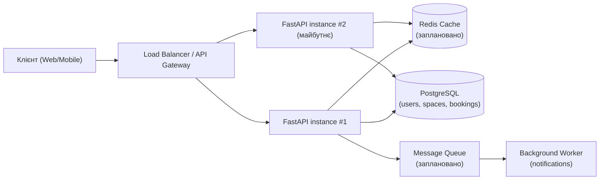

# Архітектура системи CoWork Booking

## Огляд

На старті система — класичний тришаровий монолiт (клієнт → бекенд → БД),
але спроєктований так, щоб компоненти кешування та балансування
навантаження можна було додати без переписування бізнес-логіки.

## Компоненти

- **Клієнти** — веб/мобільний застосунок, звертається лише до API Gateway /
  Load Balancer, ніколи напряму до бекенду чи БД.
- **Load Balancer / API Gateway** — єдина точка входу; у майбутньому
  розподіляє трафік між кількома інстансами бекенду (горизонтальне
  масштабування під пікові навантаження на початку тижня/місяця).
- **FastAPI Backend** — stateless-сервіс з бізнес-логікою (реєстрація,
  пошук вільних просторів, створення бронювань). Stateless — щоб можна
  було вільно масштабувати кількість інстансів.
- **PostgreSQL** — основне сховище даних, джерело істини для бронювань.
  Унікальний ключ `(space_id, start_time)` гарантує відсутність подвійного
  бронювання навіть під конкурентним навантаженням.
- **Redis (заплановано)** — кеш "гарячих" даних (список доступних
  просторів, популярні локації), щоб зняти навантаження з БД під час
  пікових READ-запитів.
- **Background worker (заплановано)** — асинхронна обробка сповіщень
  (email/push про підтвердження бронювання) поза основним запит-відповідь
  циклом.

## Діаграма

## Сценарій навантаження, який закладено в домен

Найбільш конкурентна точка системи — одночасне бронювання одного й того ж
`space_id` на однаковий `start_time` кількома користувачами (наприклад,
о 9:00 в понеділок). Захист:

1. **Зараз (lab #1):** `UNIQUE(space_id, start_time)` на рівні PostgreSQL —
   БД сама відхиляє другий конфліктний запис, ендпоінт повертає `409
   Conflict`.
2. **Далі по курсу:** оптимістичні/песимістичні блокування, розподілений
   лок через Redis, ідемпотентні запити з боку клієнта.
