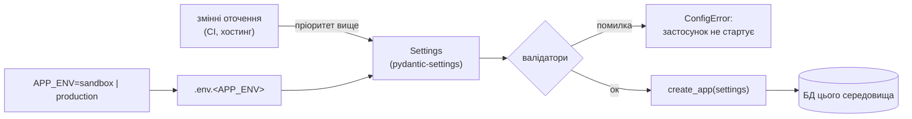

# Лабораторна робота №3 — середовища sandbox / production та CI

## Що зроблено

| Завдання | Реалізація |
|---|---|
| Вилучити hardcoded-налаштування | у коді більше немає паролів, рядків підключення та ключа JWT; поля-секрети не мають значень за замовчуванням (`app/config.py`) |
| Конфігурація з `.env.sandbox` / `.env.production` | `pydantic-settings`; файл обирається змінною `APP_ENV`; шаблони — `config/*.example` |
| Окремі БД | `coworking_sandbox` і `coworking_production`: різні контейнери, томи, порти, користувачі PostgreSQL; захист від змішування в коді |
| `DEBUG=False` у production | валідатор не дає запустити production з `DEBUG=true` |
| Без стектрейсів для користувача | власні обробники 500/404: сторінка з кодом помилки, трейсбек лише в лог |
| README | інструкції запуску обох середовищ |
| Варіант A: CI | `.github/workflows/ci.yml` — ruff, black, pytest (SQLite + PostgreSQL), міграції |

## Як обирається конфігурація

1. `APP_ENV` визначає, який файл читати: `.env.sandbox` чи `.env.production`.
2. Справжні змінні оточення мають пріоритет над файлом. Тому той самий
   код без змін працює і локально (з файлу), і в CI чи на хостингу (зі змінних).
3. Після завантаження спрацьовують перевірки. Якщо конфігурація небезпечна,
   застосунок не стартує й пояснює причину, **не показуючи значень**.

## Обґрунтування рішень

**1. Жодних значень за замовчуванням для секретів.**
У ЛР2 рядок підключення (`postgres:postgres@…`) і ключ JWT мали значення за
замовчуванням у коді. Це зручно, але небезпечно: забутий ключ у production
означав би роботу з публічно відомим ключем, яким будь-хто міг би підписати
адмінський токен. Тепер `JWT_SECRET_KEY` і параметри БД обов'язкові: без
них застосунок не запускається.

**2. Секрети як `SecretStr`.**
Пароль БД і ключ JWT зберігаються в `SecretStr`, тож у `repr()`, логах і
трейсбеках видно `**********`. У лог потрапляє URL бази з маскованим паролем
(`safe_database_url`). Помилки конфігурації перевипускаються як
`ConfigError` без вхідних даних: стандартна помилка pydantic друкує частину
значень і могла б вивести пароль у лог.

**3. Один `docker-compose.yml`, два незалежні проєкти.**
Той самий файл запускається як `-p cowork-sandbox` і `-p cowork-production`.
Docker Compose ізолює контейнери та томи за назвою проєкту, тож бази мають
окремі дані, окремих користувачів PostgreSQL з різними паролями й окремі
порти. Облікові дані compose бере з того самого env-файлу, що й застосунок.
Це одне джерело правди, і в `docker-compose.yml` немає жодного пароля.
Порти БД прив'язані до `127.0.0.1`, тож ззовні вони недоступні.

**4. Захист від змішування середовищ у коді.**
Production відмовляється працювати з базою, у назві якої є `sandbox`, `test`
чи `dev`, а sandbox — з базою, у назві якої є `prod`. Команда
`seed-demo` (демо-користувачі й простори) працює лише в sandbox. Тести
примусово перемикаються в середовище `test` з базою SQLite ще до імпорту
застосунку, тож `pytest` не може зачепити справжні дані, навіть якщо в
оболонці лишилося `APP_ENV=production`. Окремий тест це перевіряє.

**5. Режим відладки і помилки 500.**
`FastAPI(debug=settings.debug)`. У sandbox Starlette показує розробнику
повний трейсбек у браузері. У production спрацьовує власний обробник
(`app/core/errors.py`):
- генерує короткий код помилки (`24fbbc6e`);
- пише в лог повний стектрейс із цим кодом;
- браузеру віддає сторінку «Щось пішло не так» з кодом, API-клієнту —
  `{"detail": "Internal server error", "error_id": "…"}`.

Користувач може назвати код, а адміністратор за ним знайде трейсбек у лозі.
Шляхи до файлів, SQL і текст винятку назовні не потрапляють. Перевірено
вживу: при зупиненій БД sandbox показує `psycopg2.OperationalError`, а
production — лише сторінку з кодом.

**6. Swagger вимкнено в production.**
`/docs`, `/redoc` і `/openapi.json` у production повертають 404: немає потреби
публікувати повну карту API. Їх можна ввімкнути через `DOCS_ENABLED=true`.

**7. `create_app(settings)` — фабрика застосунку.**
Налаштування передаються явно, тож тести збирають застосунок у будь-якому
режимі (production без DEBUG, sandbox з DEBUG) без маніпуляцій зі змінними
оточення.

**8. Розділені залежності.**
`requirements.txt` містить лише залежності застосунку (їх ставлять у
production), а `requirements-dev.txt` додає лінтери й тести.

## CI (варіант A)

`.github/workflows/ci.yml` запускається на `push` у `main` і на кожен pull
request. Новіший push до тієї ж гілки скасовує застарілий запуск.

| Job | Що перевіряє |
|---|---|
| **lint** | `ruff check`, `black --check`, а також що жоден `.env`-файл із секретами не потрапив у git |
| **tests** (матриця Python 3.12 / 3.13) | увесь pytest на SQLite, звіт JUnit — артефактом |
| **postgres** | міграції Alembic `upgrade → downgrade → upgrade` на PostgreSQL 16, перевірка, що production не стартує з `DEBUG=true`, весь pytest на PostgreSQL |

Щоб CI справді блокував злиття, у GitHub: **Settings → Branches → Add
branch protection rule** для `main` → *Require status checks to pass* →
обрати jobs `Lint`, `Tests`, `Migrations + tests on PostgreSQL`.

Локально перед комітом ті самі перевірки запускають `make ci` і хуки
pre-commit (зокрема `detect-private-key`).

## Тести ЛР3

- `tests/unit/test_config.py` — вибір файлу за `APP_ENV`, пріоритет змінних
  оточення, обов'язковість секретів, маскування паролів, відмова production
  від `DEBUG` і слабкого ключа, ізоляція назв БД, відсутність значень у
  тексті помилки.
- `tests/integration/test_error_handling.py` — 500 у production (JSON і HTML)
  без деталей, повний трейсбек у лозі з тим самим кодом, трейсбек у
  sandbox з `DEBUG`, сторінка 404, вимкнений Swagger у production.

Усього 112 тестів; вони проходять і на SQLite, і на PostgreSQL.
