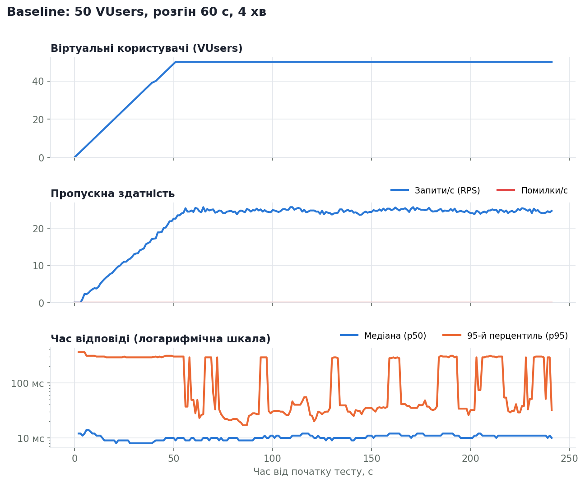
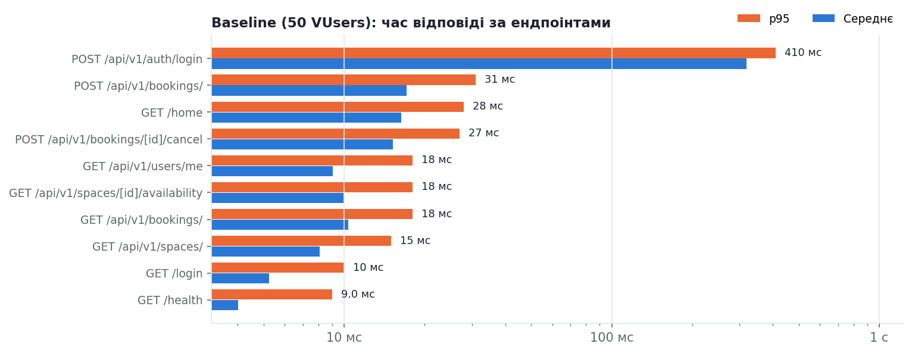
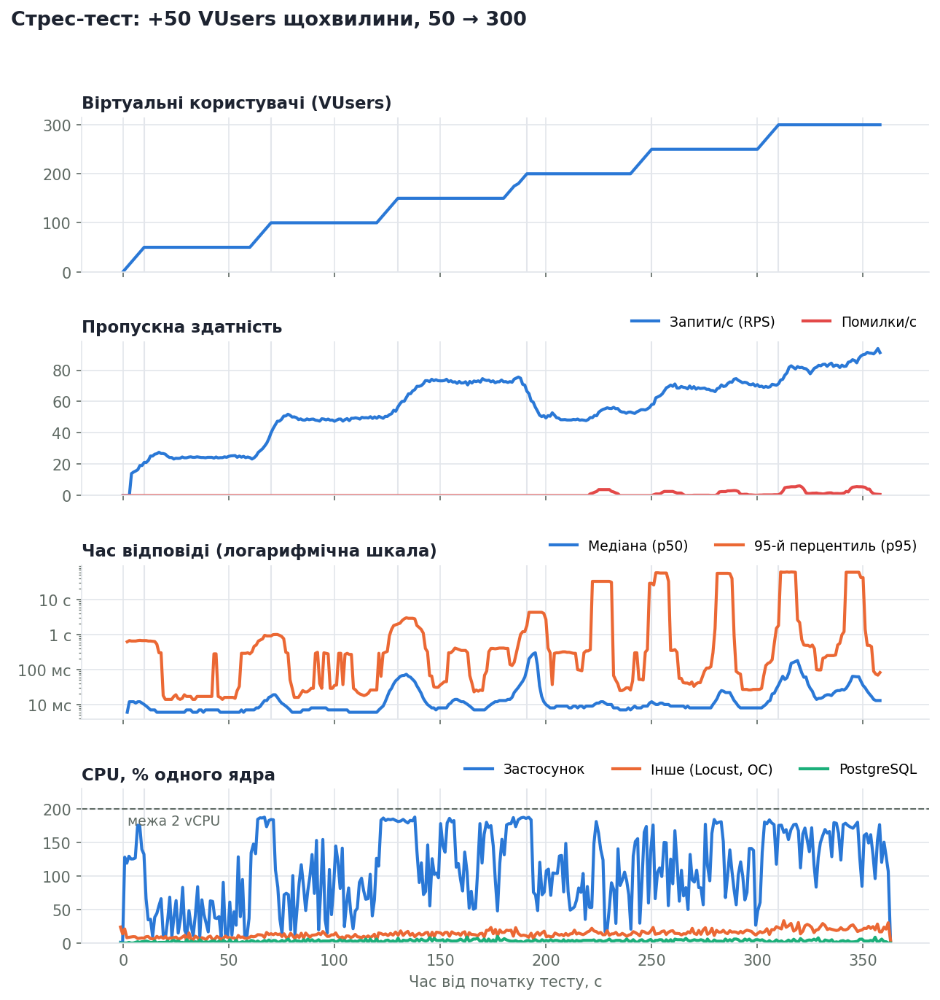
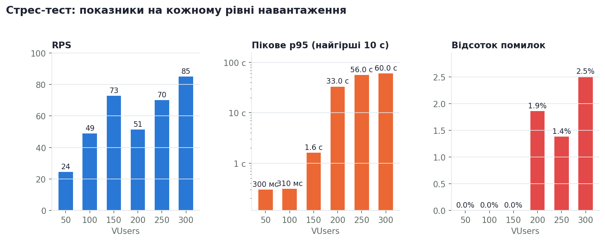

# Лабораторна робота №4 — первинне навантажувальне тестування

Об'єкт тестування — CoWork Booking (FastAPI + PostgreSQL), тестове середовище
**sandbox** з ЛР3. Інструмент — **Locust 2.31**.

## 1. Планування тестування

### Вибір інструменту

Обрано **Locust**, бо:

- сценарії пишуться на Python, тією ж мовою, що й застосунок, тож
  поведінку користувача описує звичайний код, а не XML (як у JMeter);
- профіль навантаження (розгін, ступені) задається класом `LoadTestShape`,
  тобто зберігається в репозиторії й відтворюється однаково щоразу;
- з коробки видає CSV з посекундною історією та HTML-звіт з графіками, а з
  цих CSV скрипт `loadtest/analyze.py` будує таблиці й графіки цього звіту;
- за потреби масштабується на кілька машин (master/worker).

### Цільові ендпоінти MVP

| Ендпоінт | Що робить | Хто викликає |
|---|---|---|
| `POST /api/v1/auth/login` | вхід, видача JWT (перевірка bcrypt) | Member |
| `GET /home` | кабінет: HTML-сторінка з розкладом дня | Member |
| `GET /api/v1/spaces/` | каталог просторів | обидва |
| `GET /api/v1/spaces/{id}/availability` | зайняті слоти простору на день | обидва |
| `GET /api/v1/bookings/` | мої бронювання | Member |
| `POST /api/v1/bookings/` | створити бронювання (перевірка перетину, блокування рядка) | Member |
| `POST /api/v1/bookings/{id}/cancel` | скасувати своє бронювання | Member |
| `GET /api/v1/users/me` | профіль | Member |
| `GET /login` | сторінка входу | Visitor |
| `GET /health` | перевірка стану | Visitor |

### Модель користувачів (`loadtest/locustfile.py`)

- **Member (80%)** — зареєстрований користувач. На старті входить у систему,
  далі працює в кабінеті: відкриває `/home`, дивиться простори і їх
  зайнятість, свої бронювання. Іноді бронює випадковий слот на найближчі
  30 днів, іноді скасовує своє бронювання, час від часу входить заново.
  Відповідь 409 «слот зайнятий» — нормальна бізнес-відповідь, а не помилка.
- **Visitor (20%)** — анонімний відвідувач: сторінка входу, каталог,
  зайнятість.
- **Думання між діями:** випадково 1–3 с, як у реальної людини.
- **Дані:** 300 тестових акаунтів (`loadtest/seed_users.py`), 4 простори.
  Кожен віртуальний користувач входить під своїм акаунтом.

### Профілі навантаження

| Профіль | VUsers | Розгін (Ramp-Up) | Тривалість | Мета |
|---|---|---|---|---|
| **smoke** | 10 | 2 с (5 користувачів/с) | 30 с | перевірити, що сценарій працює |
| **baseline** | 50 | 60 с (≈1 користувач/с) | 4 хв (1 хв розгону + 3 хв сталого навантаження) | контрольний запуск, базові метрики |
| **stress** | 50 → 300, +50 щохвилини | 10 с на кожен ступінь (5 користувачів/с) | 6 хв | знайти точку, де система починає здавати |

### Середовище

| Параметр | Значення |
|---|---|
| Середовище | sandbox (`APP_ENV=sandbox`), окрема БД `coworking_sandbox` |
| Сервер застосунку | uvicorn, 2 воркери, `DEBUG=false`, access log вимкнено |
| БД | PostgreSQL 16, пул SQLAlchemy за замовчуванням (5 + 10 з'єднань на воркер) |
| Машина | 2 vCPU, 8 GB RAM, Linux |
| Генератор навантаження | Locust на **тій самій** машині |

Відладку вимкнено свідомо, щоб вимірювати застосунок, а не логування. Ресурси
кожну секунду знімає `loadtest/monitor.py` (psutil): окремо CPU і RAM
застосунку (головний процес плюс воркери), PostgreSQL та решти процесів.

## 2. Контрольний запуск (baseline, 50 VUsers)



### Метрики за ендпоінтами

| Ендпоінт | Запитів | RPS | Avg | Min | Max | p95 | Помилки |
|---|---:|---:|---:|---:|---:|---:|---:|
| `GET /api/v1/spaces/` | 1195 | 5.0 | 8.1 мс | 3.6 мс | 55 мс | 15 мс | 0.00% |
| `GET /api/v1/spaces/[id]/availability` | 1124 | 4.7 | 9.9 мс | 4.9 мс | 74 мс | 18 мс | 0.00% |
| `GET /home` | 1011 | 4.2 | 16 мс | 7.7 мс | 65 мс | 28 мс | 0.00% |
| `POST /api/v1/bookings/` | 526 | 2.2 | 17 мс | 6.0 мс | 54 мс | 31 мс | 0.00% |
| `GET /api/v1/bookings/` | 495 | 2.1 | 10 мс | 5.6 мс | 35 мс | 18 мс | 0.00% |
| `POST /api/v1/auth/login` | 270 | 1.1 | 318 мс | 279 мс | 560 мс | 410 мс | 0.00% |
| `GET /api/v1/users/me` | 243 | 1.0 | 9.1 мс | 4.5 мс | 25 мс | 18 мс | 0.00% |
| `GET /login` | 236 | 1.0 | 5.3 мс | 2.7 мс | 29 мс | 10 мс | 0.00% |
| `POST /api/v1/bookings/[id]/cancel` | 204 | 0.8 | 15 мс | 8.8 мс | 55 мс | 27 мс | 0.00% |
| `GET /health` | 123 | 0.5 | 4.0 мс | 2.0 мс | 15 мс | 9.0 мс | 0.00% |
| **Усього** | 5427 | 22.6 | 27 мс | 2.0 мс | 560 мс | 65 мс | 0.00% |

### Ресурси сервера

| Ресурс | Середнє / пік |
|---|---:|
| CPU застосунку (2 воркери uvicorn), % ядра | 44 / 137 |
| CPU PostgreSQL, % ядра | 3 / 6 |
| CPU інше (Locust, ОС), % ядра | 12 / 67 |
| CPU усієї машини (2 vCPU = 200%), % | 58 / 173 |
| RAM застосунку, MB | 170 / 171 |
| RAM PostgreSQL, MB | 43 / 45 |
| RAM усієї машини (з 8 GB), MB | 679 / 686 |



**Висновок:** на 50 VUsers система працює стабільно: **22,6 RPS, 0% помилок,
медіана 10 мс, p95 65 мс**. CPU в середньому 44% одного ядра. Усі запити,
крім входу, вкладаються в 31 мс за p95. Вхід займає ~320 мс. Саме входи дають
періодичні «сходинки» p95 до ~300 мс на графіку: у вікна, де трапляються
входи, вони потрапляють у 5% найповільніших запитів.

## 3. Стрес-тест (50 → 300 VUsers)



### Показники за рівнями навантаження

Кожен рівень оцінено по сталій частині (без перших 10 с розгону). «p95
типово» — медіана поточного p95 за рівень; «p95 пік» — найгірше 10-секундне
вікно.

| VUsers | RPS | p50 | p95 (типово) | p95 (пік) | Помилки | CPU застосунку | CPU БД | CPU інше (Locust, ОС) | RAM застосунку |
|---:|---:|---:|---:|---:|---:|---:|---:|---:|---:|
| 50 | 24.5 | 6.0 мс | 17 мс | 300 мс | 0.00% | 40% | 2% | 8% | 171 MB |
| 100 | 48.9 | 7.0 мс | 29 мс | 310 мс | 0.00% | 78% | 3% | 11% | 174 MB |
| 150 | 72.7 | 10 мс | 300 мс | 1.6 с | 0.00% | 121% | 4% | 14% | 179 MB |
| 200 | 51.4 | 9.0 мс | 300 мс | 33.0 с | 1.86% | 89% | 4% | 14% | 187 MB |
| 250 | 70.0 | 8.5 мс | 76 мс | 56.0 с | 1.38% | 110% | 4% | 16% | 189 MB |
| 300 | 85.0 | 25 мс | 490 мс | 60.0 с | 2.51% | 151% | 3% | 22% | 194 MB |



### Метрики за ендпоінтами (увесь тест)

| Ендпоінт | Запитів | RPS | Avg | Min | Max | p95 | Помилки |
|---|---:|---:|---:|---:|---:|---:|---:|
| `GET /api/v1/spaces/` | 4591 | 12.7 | 719 мс | 1.6 мс | 88.5 с | 200 мс | 1.20% |
| `GET /api/v1/spaces/[id]/availability` | 4389 | 12.2 | 631 мс | 2.8 мс | 91.1 с | 170 мс | 0.62% |
| `GET /home` | 3811 | 10.6 | 513 мс | 2.4 мс | 90.9 с | 190 мс | 0.58% |
| `GET /api/v1/bookings/` | 1931 | 5.3 | 650 мс | 1.8 мс | 91.0 с | 180 мс | 2.18% |
| `POST /api/v1/bookings/` | 1901 | 5.3 | 772 мс | 1.6 мс | 91.4 с | 240 мс | 2.31% |
| `POST /api/v1/auth/login` | 1151 | 3.2 | 3.3 с | 268 мс | 97.5 с | 4.8 с | 2.52% |
| `GET /login` | 1008 | 2.8 | 267 мс | 1.4 мс | 60.3 с | 110 мс | 0.10% |
| `GET /api/v1/users/me` | 992 | 2.7 | 639 мс | 2.0 мс | 61.8 с | 180 мс | 2.82% |
| `POST /api/v1/bookings/[id]/cancel` | 736 | 2.0 | 601 мс | 5.2 мс | 86.9 с | 210 мс | 0.95% |
| `GET /health` | 547 | 1.5 | 241 мс | 1.2 мс | 33.3 с | 140 мс | 0.00% |
| **Усього** | 21057 | 58.3 | 760 мс | 1.2 мс | 97.5 с | 480 мс | 1.21% |

### Ресурси сервера

| Ресурс | Середнє / пік |
|---|---:|
| CPU застосунку (2 воркери uvicorn), % ядра | 109 / 188 |
| CPU PostgreSQL, % ядра | 3 / 10 |
| CPU інше (Locust, ОС), % ядра | 14 / 33 |
| CPU усієї машини (2 vCPU = 200%), % | 126 / 200 |
| RAM застосунку, MB | 181 / 196 |
| RAM PostgreSQL, MB | 59 / 83 |
| RAM усієї машини (з 8 GB), MB | 731 / 776 |

## 4. Підсумкова таблиця

| Метрика | Baseline (50 VUsers) | Стрес (50 → 300 VUsers) |
|---|---:|---:|
| Запитів усього | 5 427 | 21 057 |
| RPS, середнє / максимум на рівні | 22,6 / — | 58,3 / 85 (300 VUsers) |
| Latency avg | 27 мс | 760 мс |
| Latency min / max | 2 мс / 560 мс | 1 мс / 97,5 с |
| Latency p50 | 10 мс | 11 мс |
| Latency p95 | 65 мс | 480 мс |
| Error rate | **0%** | **1,21%** (255 з 21 057) |
| CPU застосунку, середнє / пік | 44% / 137% | 109% / 188% (з 200%) |
| RAM застосунку, пік | 171 MB | 196 MB |
| CPU / RAM PostgreSQL | 3% / 45 MB | 3% (пік 10%) / 83 MB |

**Межа системи на цьому залізі:** до **~100 VUsers (~50 RPS)** без помилок і
з p95 < 30 мс; **150 VUsers (~73 RPS)** — ще без помилок, але p95 у піках
1,6 с; **від 200 VUsers** з'являються помилки, а пропускна здатність падає.

## 5. Виявлені вузькі місця

### 1. Вичерпання пулу з'єднань з БД → помилки 500 і 30-секундні затримки

Головна точка відмови. Від **200 VUsers** у лозі сервера 362 рази
з'являється помилка:

```
sqlalchemy.exc.TimeoutError: QueuePool limit of size 5 overflow 10 reached,
connection timed out, timeout 30.00
```

Пул SQLAlchemy за замовчуванням має 5 + 10 = **15 з'єднань на воркер**, а
FastAPI обробляє синхронні ендпоінти в пулі з **40 потоків**. Коли запитів
більше, ніж з'єднань, решта запитів чекає на вільне з'єднання до 30 с і
падає з 500. На графіку p95 це «плато» на 33–60 с (300 VUsers). Пропускна
здатність при цьому **падає** з 73 до 51 RPS на переході 150 → 200 VUsers,
хоча користувачів більше: запити стоять у черзі за з'єднаннями.

Чому з'єднання тримаються так довго — див. пункт 2.

### 2. Вхід (bcrypt) — найдорожча операція, і він тримає з'єднання з БД

`POST /api/v1/auth/login` — **~320 мс** навіть без навантаження, у 20–30 разів
повільніше за будь-який інший запит (≈10 мс). Це bcrypt з вартістю 12:
алгоритм навмисно повільний, щоб ускладнити перебір паролів. Під
навантаженням вхід стає ще повільнішим (p95 **4,8 с**), бо bcrypt займає CPU.

Важливо, що сесія БД відкривається на початку запиту і тримає з'єднання **весь
час**, поки рахується bcrypt. Отже, кожен вхід займає одне з 15 з'єднань на
сотні мілісекунд, хоча сам SQL-запит триває ~1 мс. Саме тому пул вичерпується.

**Каскадний ефект:** якщо вхід віртуального користувача падає з 500, той не
отримує токен, і всі його наступні запити отримують **401**. Так 151 помилка
500 потягнула за собою ще 78 відповідей 401.

### 3. CPU застосунку впирається в 2 ядра

Від 150 VUsers CPU застосунку тримається біля **185–188%** з 200% можливих.
Оцінка того, куди йде CPU: одна перевірка bcrypt на цій машині займає
~0,28 с процесорного часу (мінімальний час входу — 268–279 мс). За стрес-тест
було 1 151 вхід, тобто ≈ 320 с CPU на bcrypt. Застосунок за ~360 с тесту
спожив у середньому 109% ядра, тобто ≈ 390 с CPU. Отже, **близько 80%
процесорного часу сервера витрачається на перевірку паролів**, хоча входи —
лише 5% запитів. (У baseline: 270 × 0,28 ≈ 76 с з ≈ 106 с, теж ~70%.)

Locust працює на тій самій машині й забирає ще 15–30% CPU, тож реальна межа
сервера на окремій машині буде дещо вищою.

### 4. Що НЕ є вузьким місцем

- **PostgreSQL**: 3% CPU в середньому, максимум 10%, до 83 MB RAM. Запити до
  БД прості й індексовані, тож база простоює, поки застосунок чекає на пул.
- **Пам'ять застосунку**: 170 → 196 MB за весь тест, без ознак витоку.
- **Цілісність бронювань**: після стрес-тесту в БД 661 активне бронювання і
  **жодної** пари, що перетинається за часом (перевірено SQL-запитом). Отже,
  блокування рядка простору з ЛР2 працює навіть під перевантаженням, а
  конфлікти коректно отримують 409.

## 6. Рекомендації (на наступні лабораторні)

| Проблема | Що зробити |
|---|---|
| Пул вичерпується | збільшити `pool_size`/`max_overflow` відповідно до кількості потоків; зменшити `pool_timeout` до 2–5 с, щоб падати швидко, а не чекати 30 с |
| Вхід тримає з'єднання під час bcrypt | читати користувача, закривати сесію, і лише потім перевіряти пароль; або винести bcrypt в окремий пул потоків |
| ~80% CPU на bcrypt | обмежити частоту входів (rate limit), що також захищає від перебору паролів; довше життя токена, щоб входити рідше |
| CPU на 2 ядрах | більше воркерів/інстансів за балансувальником (бекенд stateless завдяки JWT, ЛР2) |
| Часті однакові запити каталогу | кеш списку просторів у Redis (заплановано в архітектурі ЛР1) |
| Чесність вимірювань | запускати Locust на окремій машині |

## Як відтворити

```bash
pip install -r requirements-loadtest.txt
make setup-sandbox                       # БД sandbox + міграції (ЛР3)
APP_ENV=sandbox python -m loadtest.seed_users --users 300

# сервер у режимі для вимірювань (окремий термінал)
APP_ENV=sandbox DEBUG=false LOG_LEVEL=WARNING \
    uvicorn app.main:app --port 8000 --workers 2 --no-access-log

make loadtest-baseline    # 4 хв, результати в loadtest/results/
make loadtest-stress      # 6 хв
make loadtest-report      # таблиці (summary.md) і графіки (*.png)
```

Інтерактивні звіти Locust: `loadtest/results/baseline.html`, `stress.html`.
Абсолютні цифри залежать від машини: на іншому комп'ютері вони будуть
іншими, але характер вузьких місць той самий.
